 
 
 
 
 
 

## About DFK Labs

DFK Labs builds small software for iPhone, Apple Watch and the web that works offline, on-device and
without an account: no servers, no accounts, no tracking. Everything is at [dfklabs.com](https://dfklabs.com).

### Apps

- **[Birdio](https://dfklabs.com/birdio)**, for iPhone and Apple Watch: the free golf app. Your real handicap, every round remembered.
- **[Cooked](https://dfklabs.com/cooked)**, for iPhone: your feeds, measured in metres.
- **[Nitnoi](https://dfklabs.com/nitnoi)**, for Apple Watch and iPhone: the words and the money of your trip on your Apple Watch.
  Sixteen words carry a market stall.
- **[Cue](https://dfklabs.com/cue)**, for Apple Watch and iPhone: discreet speaker notes for Apple Watch. Your speech, on your wrist.
- **[Quakes](https://dfklabs.com/quake)**, on the web: a live earthquake tracker and map. Every earthquake on Earth, minutes after it happens.
- **[Studio](https://studio.dfklabs.com)**, on the web: 66 free browser tools that never upload your files.

### Open source

- **[airgap](https://github.com/DFKlabs/airgap)**: text over sound. Open [dfklabs.com/labs/airgap](https://dfklabs.com/labs/airgap)
  on two phones with flight mode on: one chirps a message and the other reads it, with no internet, no server and
  no account. It is a modem in about 330 lines of JavaScript with no dependencies: 16 tones from 1.0 to 3.4 kHz
  carry 4 bits each, messages travel in packets of up to 20 bytes with a CRC-16 checksum, and the receiver decodes
  them with the Goertzel algorithm. MIT License.
- **[deploybudget](https://github.com/DFKlabs/deploybudget)**: stop Vercel from building every branch you push. A drop-in
  `vercel.json` keeps automatic deployments for your production branch only, which fixes "Deployment rate
  limited — retry in 24 hours" on the Hobby plan and stops paying for builds nobody opens on Pro, where build
  minutes are metered.
  `apply.mjs` (Node 18 or newer, zero dependencies) applies it to every project in a folder at once, and it also
  installs as a Claude Code plugin. Apache-2.0; the templates are CC0.

### Follow DFK Labs

[dfklabs.com](https://dfklabs.com) · [X: @dfklabs](https://x.com/dfklabs) · [Instagram: @dfklabs](https://instagram.com/dfklabs) ·
[Reddit: r/dfklabs](https://www.reddit.com/r/dfklabs) · [all repositories](https://github.com/orgs/DFKlabs/repositories)
