  

  
  
  

  
  
  

  <a href="https://dfklabs.com/birdio"><b>Birdio</b></a>, the free golf app for iPhone and Apple Watch: your real handicap, every round remembered ·
  <a href="https://dfklabs.com/cooked"><b>Cooked</b></a>, your feeds measured in metres for iPhone ·
  <a href="https://dfklabs.com/nitnoi"><b>Nitnoi</b></a>, the words and the money of your trip on your Apple Watch ·
  <a href="https://dfklabs.com/cue"><b>Cue</b></a>, discreet speaker notes for Apple Watch ·
  <a href="https://dfklabs.com/quake"><b>Quakes</b></a>, a live earthquake tracker and map ·
  <a href="https://studio.dfklabs.com"><b>Studio</b></a>, free browser tools that never upload your files

  
  

  <a href="https://github.com/DFKlabs/airgap"><b>airgap</b></a>: send text between two phones with sound, no internet, no server ·
  <a href="https://github.com/DFKlabs/deploybudget"><b>deploybudget</b></a>: stop Vercel from building every branch you push

  
  
  

  <a href="https://dfklabs.com"><b>dfklabs.com</b></a> ·
  <a href="https://x.com/dfklabs">X @dfklabs</a> ·
  <a href="https://instagram.com/dfklabs">Instagram @dfklabs</a> ·
  <a href="https://www.reddit.com/r/dfklabs">Reddit r/dfklabs</a>

